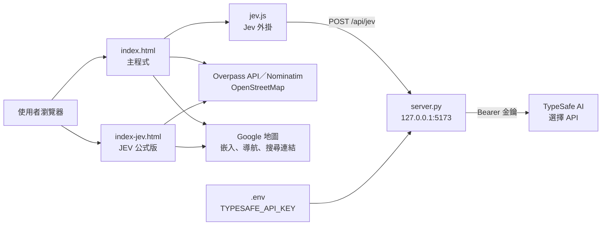

# meal-buddy（今天吃什麼）

「今天吃什麼」餐廳推薦網頁：從 OpenStreetMap（Overpass API）找出附近餐廳，依餐別、交通方式、類別與最近吃過的紀錄抽出一道菜和一家店；另有選用的「Jev」外掛，把一句話的需求交給外部 AI 選擇 API 挑店。

## 功能

### 主程式（`index.html`）

- **地點**：用瀏覽器定位，或輸入地名（OpenStreetMap Nominatim 搜尋）。定位失敗時先用台北 101 附近示範。
- **找附近餐廳**：向 Overpass API 查詢（內建 3 個端點），查詢失敗時改用程式內的示範資料，並在畫面上提示。
- **篩選條件**：哪一餐（早餐／午餐／晚餐／宵夜）、怎麼去（走路／機車／大眾運輸／開車，加上最多願意花幾分鐘）、想吃的類別（可複選）、不能吃（依店名判斷）、避開最近兩天吃過的菜色、冒險度。
- **營業時間**：解析 OSM 的 `opening_hours`，排除沒營業或到店前就打烊的店；看不懂的格式當作「不知道」，不排除。
- **抽籤**：先抽一道菜，再從附近店家挑一家（店名直接有這道菜的優先，否則找同類型），距離越近、越久沒吃的分數越高；冒險度 0 永遠挑最高分，越高越隨機。
- **結果操作**：Google 地圖導航、Google 看評價、換一家、換道菜、「就吃這個」記錄到「最近吃過」。
- **紀錄與設定**：最近吃過（最多 30 筆）、各項設定與附近餐廳的查詢快取存在瀏覽器 `localStorage`。

### Jev 外掛（`jev.js` ＋ `server.py`，選用）

`index.html` 最下面載入 `jev.js`，會在篩選卡片下方多一張「跟 Jev 說你想吃什麼」卡片：

1. 使用者輸入一句話，或點快速選項（例如「好冷，想吃熱的」）。
2. `jev.js` 取目前距離與類別條件下、最近的最多 80 家店，每家附上英文描述（類型、距離與步行／機車時間、營業時間），再加上餐別、當地星期與時間、最近 5 筆吃過的紀錄，組成兩個 `type: 'choice'` 問題（挑菜色、挑店家），以 `model: 'jev-latest'` 經本機 `server.py` 送到 TypeSafe AI。
3. 店家選項固定多一個 `none of these fit`；如果 Jev 選了它，畫面會說明附近的店都不太符合，並附上 Google 地圖搜尋連結。
4. 取回各選項的機率與 `confidence`，列出前 5 家；第一名的信心低於 0.5 時，提示「前幾名差不多」，讓使用者自己挑。
5. 卡片右上角可以關閉 Jev，開關狀態存在 `localStorage`。

### 本機伺服器（`server.py`）

只用 Python 標準函式庫，綁定 `127.0.0.1`：

- 提供靜態檔案，並代轉 `POST /api/jev` 到 TypeSafe API；`GET /api/jev/status` 回報金鑰是否已設定。
- API 金鑰只從環境變數或 `.env` 讀取，不會出現在網頁裡；檔名以 `.env` 開頭的請求一律回 404。
- 只接受 Host 為本機、Origin 與 Host 一致、`Content-Type` 為 JSON、body 不超過 512 KB 的請求。
- 上游回 429 或 529 時依 `retry-after-ms`／`Retry-After` 等待後重試（單次最多等 5 秒，總共最多 3 次）。

### JEV 整合版（`index-jev.html`）

另一個獨立版本，不載入 `jev.js`、不需要 API 金鑰，在瀏覽器內用公式計分（「⚙️ 進階：JEV 決策設定」可調整）：

- **JEV** ＝ P(去得成且開著) × Σ(權重 × 分項分數) ÷ Σ權重。
- 分項分數（0～1）：時間、預算、口味、菜色、新鮮感，權重可調（預設 3／2／3／4／2）。
- P 依營業時間未知、快打烊、下雨走路、雨天騎車、大熱天走路等情況打折；踩到不能吃、沒營業、到店就打烊、太遠、不想吃的類別則直接排除。
- 從 JEV 前 10～50 名中以 softmax 抽籤：抽中機率 ∝ exp(JEV ÷ 溫度)，溫度由「冒險度」決定。
- 均消是依餐廳類型估計（開放地圖沒有價位資料），天氣由使用者自己選。

`index.html` 與 `index-jev.html` 兩版並存，各自獨立運作。

## 架構



| 檔案 | 用途 |
| --- | --- |
| `index.html` | 主程式（單檔 HTML／CSS／JS），最下面載入 `jev.js` |
| `jev.js` | Jev 外掛，透過 `window.SanCan` 取得主程式的資料與函式 |
| `index-jev.html` | JEV 公式計分的獨立版本 |
| `server.py` | 本機靜態伺服器與 TypeSafe API 代轉 |
| `start.bat` | Windows 雙擊啟動 `python server.py --open` |
| `.env.example` | 金鑰設定範例 |
| `index.備份-20261001.html` | 舊版 `index.html` 備份 |
| `docs/superpowers/` | 「飯友配對」Demo 的設計規格與實作計畫（Demo 程式不在這個 repo） |

## 技術

- 前端：HTML、CSS、原生 JavaScript（無建置步驟、無框架）
- 本機伺服器：Python 3，只用標準函式庫（`http.server`、`urllib`）
- 外部服務：OpenStreetMap Overpass API、Nominatim、Google 地圖（嵌入與連結）、TypeSafe AI（僅 Jev 外掛）

## 如何執行

不用 Jev：直接用瀏覽器開啟 `index.html` 或 `index-jev.html`（沒有本機伺服器時，Jev 卡片會顯示需要啟動 `server.py` 的提示）。

要用 Jev：

1. 複製 `.env.example` 為 `.env`，填入自己的 `TYPESAFE_API_KEY`（`.env` 已列入 `.gitignore`）。
2. 啟動本機伺服器：

   ```bash
   python server.py           # http://localhost:5173
   python server.py --open    # 同時打開瀏覽器
   python server.py 8080      # 改用其他 port
   ```

   Windows 也可以直接雙擊 `start.bat`。
3. 打開 `http://localhost:5173`；`index-jev.html` 也可以用 `http://localhost:5173/index-jev.html` 開啟。

## 環境變數

| 變數 | 用途 |
| --- | --- |
| `TYPESAFE_API_KEY` | TypeSafe API 金鑰。優先讀環境變數，沒有才讀 `.env`；每次請求重新讀取，改了 `.env` 不用重開伺服器 |
| `TYPESAFE_API_URL` | 選用，覆寫 TypeSafe API 端點（預設值寫在 `server.py`） |

## 測試

目前沒有自動化測試。

## 限制與已知問題

- 餐廳資料、營業時間與類別來自 OpenStreetMap，可能不完整或過時；「不能吃」只依店名與標籤判斷，僅供參考。
- Overpass 與 Nominatim 是公共服務，有流量限制，查詢失敗時會改用示範資料。
- 定位座標會送到 Overpass、Nominatim 與 Google 地圖（嵌入地圖和導航連結）。
- 頁尾寫「你的位置……不會被儲存」，但附近餐廳的查詢快取（`localStorage` 的 `sancan.shopCache`）會以取到小數點後 3 位的座標當快取鍵，存在使用者自己的瀏覽器裡；頁尾文字與實作不完全一致。
- 使用 Jev 時，輸入的句子、餐別、時間、最近 5 筆吃過的紀錄與附近最多 80 家店的名稱和描述會經由 `server.py` 送到 TypeSafe AI；送出的資料不含座標。
- Jev 的推薦品質取決於外部 API，本 repo 沒有對它的結果做過評估。
- 使用者自己打的句子會原文送出；只有快速選項附有英文版本。
- `index.html` 與 `index-jev.html` 有大量重複程式碼，修改時需要兩邊各自處理。
