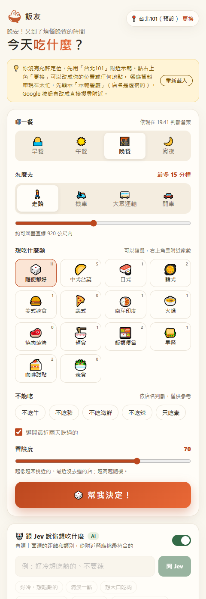
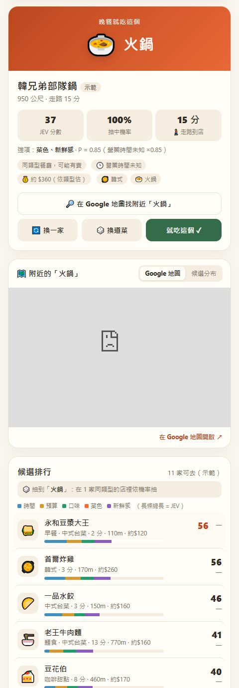
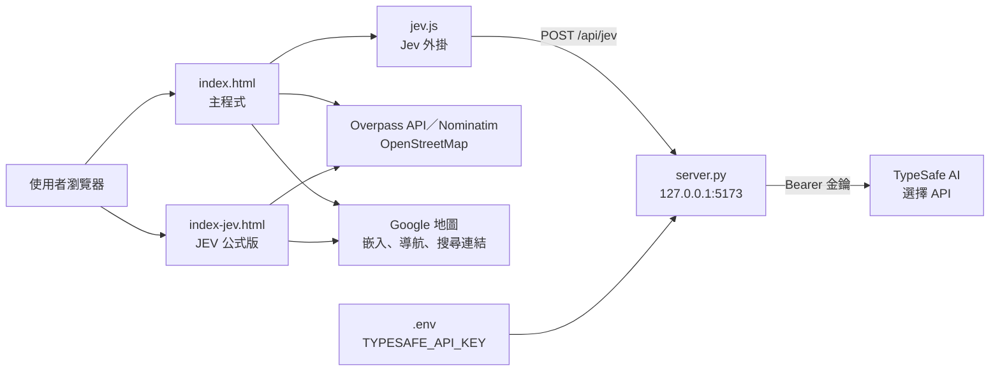

# meal-buddy（今天吃什麼）

> 純前端的「今天吃什麼」餐廳推薦網頁：用 OpenStreetMap 找附近餐廳，依餐別、交通時間、類別、營業時間與最近吃過的紀錄抽出一道菜和一家店；另有一個把自然語言需求交給外部 AI「選擇 API」挑店的 Jev 外掛，以及一個可調權重的期望值（JEV）公式版。

## 要解決的問題

「今天吃什麼」每天都要想，而地圖 App 只會列出一長串店家，不會幫你決定。這個專案想把「現在幾點、願意走多遠、最近吃過什麼、現在想吃什麼」這些條件一次考慮進去，直接給出一個能去、有開、最近沒吃過的選擇，並保留一點隨機性。

## Demo

**線上 Demo**：[主程式](https://mina201199.github.io/meal-buddy/)｜[JEV 公式版](https://mina201199.github.io/meal-buddy/index-jev.html)

線上版是 GitHub Pages 靜態網頁，沒有 `server.py`，所以 Jev AI 卡片只會顯示需要啟動本機伺服器的提示；要試 Jev 請依下方「如何執行」在本機啟動。

以下截圖是在本機執行 `server.py`、並擋掉所有外部網路請求時拍的，因此畫面用的是程式內建的**示範餐廳（店名為虛構）**，地點為預設的台北 101 附近；Google 地圖嵌入因為被擋掉而顯示空白。

| 主程式：篩選條件與 Jev 外掛卡片（`index.html`） | JEV 公式版：抽籤結果與候選排行（`index-jev.html`） |
| --- | --- |
|  |  |

## 架構



| 檔案 | 用途 |
| --- | --- |
| `index.html` | 主程式（單檔 HTML／CSS／原生 JavaScript），最下面載入 `jev.js` |
| `jev.js` | Jev 外掛，透過 `window.SanCan` 取得主程式的資料與函式 |
| `index-jev.html` | JEV 公式計分的獨立版本，不需要 API 金鑰 |
| `core.js` | 兩個頁面共用的純函式（距離、營業時間解析、softmax 等），瀏覽器與 Node 測試共用 |
| `server.py` | 本機靜態伺服器與 TypeSafe API 代轉，只用 Python 標準函式庫 |
| `start.bat` | Windows 雙擊啟動 `python server.py --open` |
| `tests/` | `core.test.js`（Node）與 `test_server.py`（Python）自動化測試 |

## 技術重點與設計決策

### 規則式推薦（`index.html`）

- **找店**：向 Overpass API 查詢（內建 3 個端點），失敗時改用程式內的示範資料並在畫面上提示，不會整頁壞掉。
- **營業時間**：解析 OSM 的 `opening_hours`，排除沒營業或「走到時已打烊」的店；看不懂的格式當作「不知道」，不排除。
- **抽籤**：先抽菜再挑店（店名直接有這道菜的優先，否則找同類型）；距離越近、越久沒吃的分數越高。「冒險度」0 永遠挑最高分，越高越隨機。

### AI 外掛：自然語言 → 結構化選擇（`jev.js` ＋ `server.py`）

- 使用者輸入一句話（例如「好冷，想吃熱的」），`jev.js` 取目前條件下最近的**最多 80 家店**（`MAX_SHOPS`），每家附上英文描述（類型、距離、步行／機車時間、營業時間），再加上餐別、當地時間與最近 5 筆吃過的紀錄，組成兩個 `type: 'choice'` 問題（挑菜色、挑店家），以 `model: 'jev-latest'` 送到 TypeSafe AI。
- **讓 AI 只能從候選清單裡選**，不讓它自由生成店名，避免推薦不存在的店；店家選項固定多一個 `none of these fit`，選到時畫面會誠實說明附近沒有適合的店。
- **用信心分數決定要不要替使用者做決定**：取回各選項機率與 `confidence`，列出前 5 家；第一名信心低於 0.5（`LOW_CONFIDENCE`）時提示「前幾名差不多」，讓使用者自己挑。
- **金鑰不進前端**：`server.py` 代轉請求，金鑰只從環境變數或 `.env` 讀取；檔名以 `.env` 開頭的請求一律回 404；只接受 Host 為本機、Origin 與 Host 一致、`Content-Type` 為 JSON、body 不超過 512 KB 的請求；上游回 429／529 時依 `Retry-After` 等待重試（最多 3 次）。

### JEV 公式版（`index-jev.html`）

- **JEV** ＝ P(去得成且開著) × Σ(權重 × 分項分數) ÷ Σ權重；分項為時間、預算、口味、菜色、新鮮感，權重可在「進階：JEV 決策設定」調整。
- P 依營業時間未知、快打烊、下雨走路、雨天騎車、大熱天走路等情況打折；踩到「不能吃」、沒營業、太遠等條件直接排除。
- 從前 10～50 名中以 softmax 抽籤（機率 ∝ exp(JEV ÷ 溫度)），溫度由「冒險度」決定，候選排行用分項長條顯示每家的分數構成，讓推薦理由看得見。

## 成果與數字

這是個人練習用的原型，**沒有使用者數據，也沒有對 Jev 推薦品質做過評估**，因此這裡不列成效數字。可確認的規模：`index.html` 約 1,450 行、`index-jev.html` 約 1,780 行、`jev.js` 約 380 行、`core.js` 約 110 行、`server.py` 約 170 行（`wc -l`）。

## 測試

不需要安裝任何套件，在 repo 根目錄執行：

```bash
node --test
python -m unittest discover -s tests
```

- `tests/core.test.js`：營業時間解析（跨夜、跨週、看不懂的格式）、是否營業與打烊時間、距離、餐別判斷、加權抽籤與 softmax。需要 Node.js 20 以上。
- `tests/test_server.py`：金鑰讀取順序、429／529 重試、不讓瀏覽器讀到 `.env`、拒絕其他網站與非 JSON 請求、請求大小限制、上游失敗回 502。

畫面互動與 Jev 外掛目前沒有自動化測試。

## 如何執行

需要 Python 3（只用標準函式庫，不必安裝套件）。

**不用 Jev**：直接用瀏覽器開 `index.html` 或 `index-jev.html` 即可。

**要用 Jev**（需要自己的 TypeSafe API 金鑰）：

1. 複製 `.env.example` 為 `.env`，填入 `TYPESAFE_API_KEY`（`.env` 已列入 `.gitignore`）。
2. 啟動本機伺服器，開啟 <http://localhost:5173>：

   ```bash
   python server.py           # http://localhost:5173
   python server.py --open    # 同時打開瀏覽器
   python server.py 8080      # 改用其他 port
   ```

   Windows 也可以直接雙擊 `start.bat`。`TYPESAFE_API_URL` 可選擇性覆寫 API 端點。

## 已知限制與下一步

- 畫面互動與 Jev 外掛沒有自動化測試；Jev 的推薦品質取決於外部 API，本 repo 沒有做過評估。
- 餐廳資料、營業時間與類別來自 OpenStreetMap，可能不完整或過時；「不能吃」只依店名與標籤判斷，僅供參考。均消依餐廳類型估計，天氣由使用者自己選。
- Overpass 與 Nominatim 是公共服務，有流量限制，失敗時會改用示範資料。
- **隱私**：定位座標會送到 Overpass、Nominatim 與 Google 地圖。使用 Jev 時，輸入的句子、餐別、時間、最近 5 筆紀錄與附近最多 80 家店的名稱和描述會送到 TypeSafe AI（不含座標）。頁尾寫「你的位置……不會被儲存」，但附近餐廳的查詢快取（`localStorage` 的 `sancan.shopCache`）會以取到小數點後 3 位的座標當快取鍵，存在使用者自己的瀏覽器裡，文字與實作不完全一致。
- 使用者自己打的句子會原文送出；只有快速選項附有英文版本。
- 共用的純函式已移到 `core.js`，但 `index.html` 與 `index-jev.html` 其餘部分仍有大量重複程式碼，修改時要兩邊各自處理。
- **下一步**：把評分與資料處理也抽成共用模組、補上畫面互動測試、建立一小組情境來評估 Jev 的推薦是否符合需求。

## 我負責的部分

個人專案，獨立完成：需求、介面與互動設計、推薦規則與 JEV 公式、AI 外掛串接、本機代轉伺服器與文件。

## 授權

程式碼以 [MIT License](LICENSE) 釋出。餐廳資料 © OpenStreetMap 貢獻者（ODbL）。
